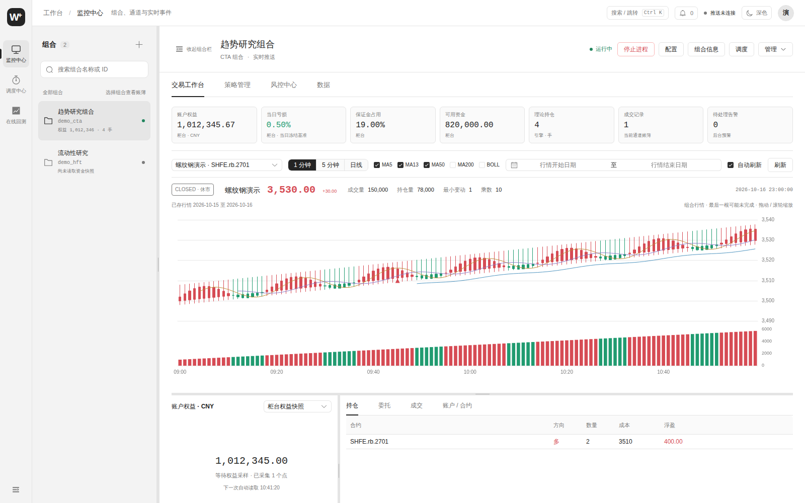
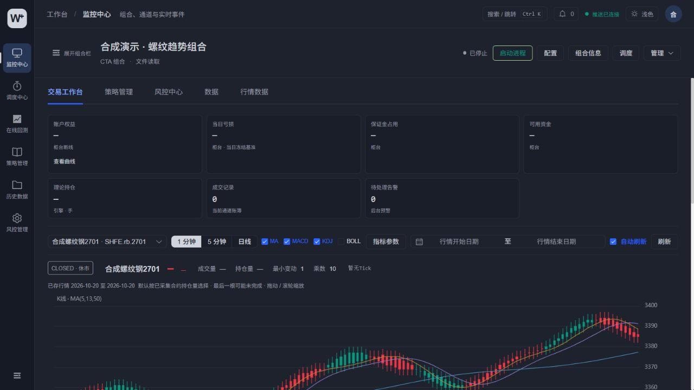
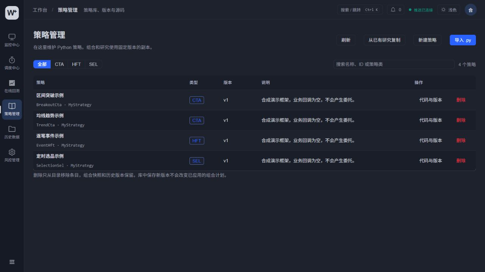
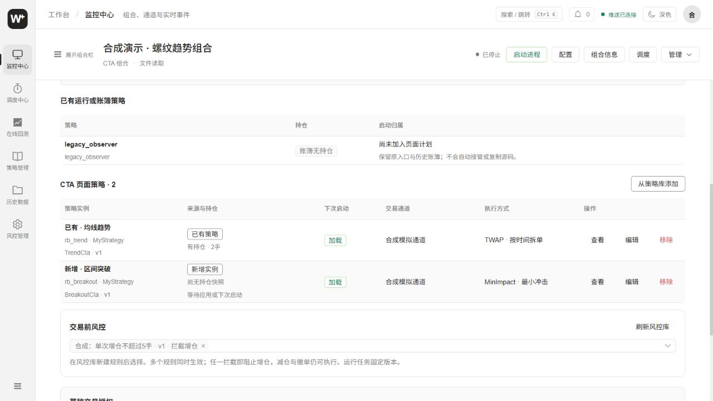
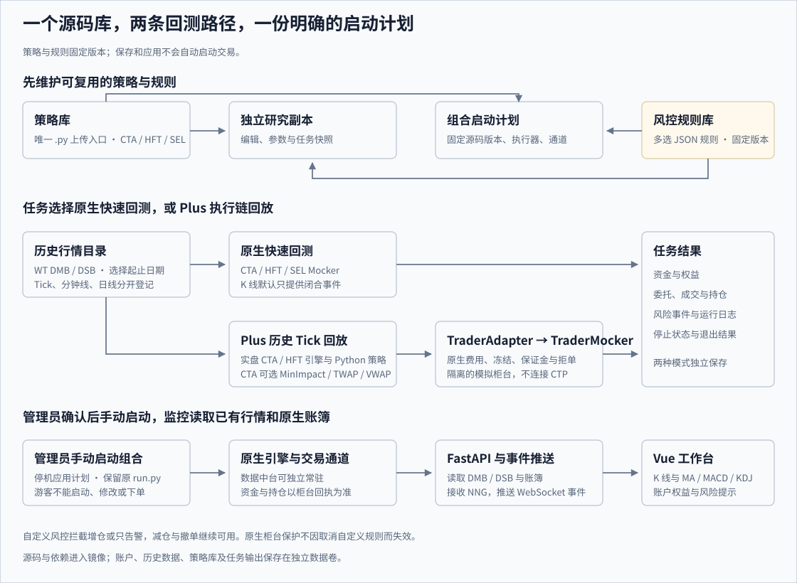
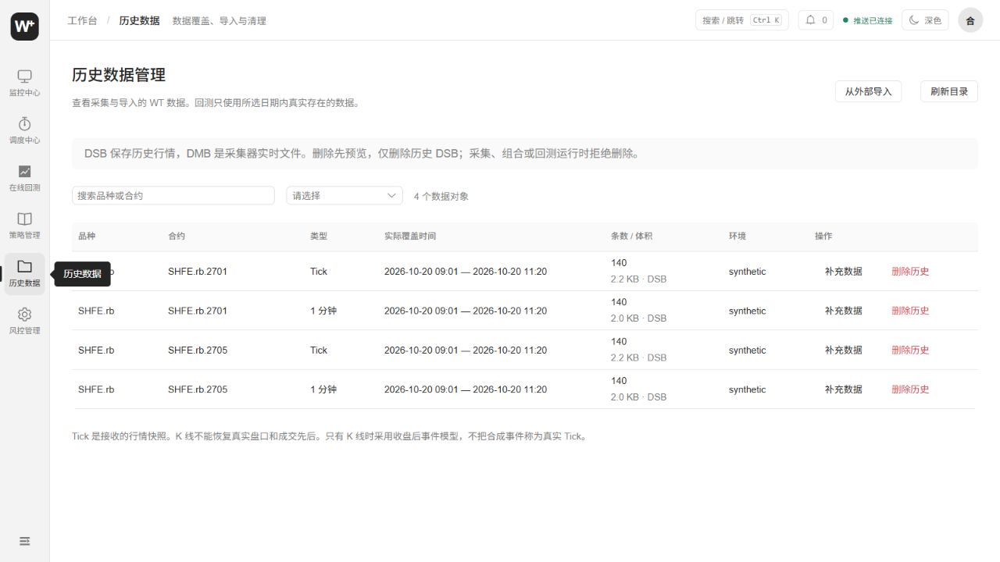

# wtpy-plus

基于 [wtpy](https://github.com/wondertrader/wtpy) 的二次开发。
保留上游来源、MIT 许可和 Git 历史。
本仓库不是 wtpy 官方发行版。

原版 wtpy 是 WonderTrader 的 Python 子框架。
它提供策略接口、回测、数据工具和监控服务。
本项目配合 [WonderTrader-plus](https://github.com/newbigdeng/WonderTrader-plus) 使用。
C++ 负责引擎、委托和账户账簿。
Python 负责任务、策略接口和网页服务。

## 怎么读这个仓库？

先按 Docker 步骤启动空工作台。
再登记数据，选择快速回测或 Plus 回测。
账户配置和运行输出始终放在数据卷里。

## 工作台有哪些功能？

同一个网页管理策略、行情、交易与回测。





- 监控中心：组合、策略、行情、资金和风险。
- 调度中心：启停进程、定时任务和配置对比。
- 在线回测：原生／Plus 切换、自选日期与结果详情。
- 策略管理：按 CTA、HFT、SEL 分类维护版本。
- 历史数据：查看 Tick、分钟线及日线文件。
- 数据工作台：切换策略、组合和通道维度。
- 表格：关键词、时间、列选择和 CSV 导出。
- 风险面板：权益、保证金、可用资金和拒单。
- 策略控制：分开提供暂停决策和原生过滤。
- 策略接入：选库版本、配置参数、执行器和通道。
- 风控库：多选规则，按固定版本接入运行任务。
- 通道配置：停机后切换已登记的环境。
- 合约管理：从看盘订阅行情，按策略查看运行合约。
- 合约计划：停机后增删同品种合约，均分原有预算。

界面支持黑白主题，也可跟随系统。
组合侧栏能整体收起，小窗口改用抽屉。
看盘自动刷新可选，图表和页面允许纵向滚动。
手机使用底部导航，组合和研究列表改用抽屉。
手机图表提供缩放滑块，资金与账本纵向排列。
Ctrl+K 打开命令入口。
组合和页签保存在链接中，刷新会恢复会话。

风险告警支持确认和定时静默。
自动基准按交易日固定，不随盘中资金重写。
柜台断开或账户过旧时，柜台指标显示未知。
手续费与资金查询来自原生回报。
“已请求”与“已收到新资金回报”分开判断。

## Python 策略应该放在哪里？

策略库统一维护源码，组合和研究各自取副本。

同一策略可能用于多个组合。
如果库文件一改就热加载，持仓和参数容易错配。
所以保存生成新版本，组合明确选择后才生效。



1. 进入左侧“策略管理”，选择类型。
2. 导入 `.py`，或创建已有回调的策略框架。
3. 编辑代码和说明，再保存库版本。
4. 在线回测从库复制，研究修改不回写库。
5. 交易组合选择库版本，再配置实例与通道。

文件上传只在“策略管理”提供。
组合页面不接收任意源码上传。
已有研究可点击“从已有研究复制”。
原研究代码、历史回测和结果都保留。

默认库目录是 `/data/strategy-library`。
可用 `WT_STRATEGY_LIBRARY_ROOT` 更换位置。
每个条目有稳定 ID，源码按版本单独保存。
从库删除会归档，已有计划仍能读取原版本。

## 怎样给组合添加或移除策略？

新组合和已有组合都能保存独立的启动计划。

研究页中的策略不会自动加入交易组合。
进入监控中心的“策略管理”，配置实际交易实例。
保存草稿、应用配置和启动进程分别操作。

1. 新组合先选环境模板，再选 CTA 或 HFT。
2. 从对应类型的策略库选择版本。
3. 填写唯一实例 ID、显示名称和参数。
4. 选择已配置的交易通道。
5. CTA 再选择 MinImpact、TWAP 或 VWAP。
6. 保存草稿，停机后应用，再决定是否手动启动。



页面并列展示旧入口策略和托管计划。
“新增实例”表示尚无运行或账簿记录。
持仓状态来自策略账簿，缺少快照会标明未知。
“等待应用”不代表当前进程已经加载。

已有组合首次应用时，需要确认切换启动入口。
原 `run.py` 保留，页面使用独立固定入口。
旧入口中的策略不会自动迁移。
改动有持仓策略的代码、参数或通道会被拒绝。
HFT 还要核对通道持仓和委托成交快照。
从组合移除只改变启动计划，不删除库策略。

保存时只解析 Python 语法，不执行用户代码。
启动后，独立进程调用原有 `WtEngine` 接口。
CTA 使用原生策略路由、执行器和交易适配器。
HFT 直接使用所选交易通道。

新组合不复制旧账簿、委托和一次性交易许可。
自动守护、定时启动和交易授权默认关闭。
只有管理员能修改计划，游客仅能查看概要。

停止进程不会清空历史信号，也不会自动平仓。
原生 CTA 可恢复已落盘的未触发信号。
重启前仍需核对策略目标、账户持仓和挂单。

## 账户权益曲线怎样读取？

曲线记录真实柜台权益，不用组合损益代替本金。

账户权益等于柜台余额加浮动盈亏。
每个账户、币种按资金回执时间保存采样。
重复读取同一份回执，不会新增采样点。
旧版仅保存余额的缓存另存，不冒充权益。

- 顶部账户卡可直接打开曲线。
- 支持今日、近七天、全部与展开查看。
- 一个采样点也会显示，并注明实际时间。
- 断线或过期会明确标注，不伪造盘中更新。

MA 叠加在 K 线主图。
成交量、MACD、KDJ 各占一个面板。
悬浮提示只显示鼠标所在面板的数值。
颜色点与对应线条或当前柱子的涨跌颜色一致。
指标参数可修改，图表缩放与时间轴联动。
显示开关和参数保存在浏览器。

默认合约按最新已存交易日的持仓量选择。
只比较本机已采集的合约，不代表全市场排名。
手动选择合约后，刷新行情不会强制切换。

## 游客可以操作哪些内容？

游客共享页面导航，但不能修改或控制进程。

后端只开放明确登记的读取接口。
新增接口默认不向游客开放。
源码、构造参数、账户密钥和原始日志不下发。
启停、保存、导入、回测运行均检查操作权限。
原生风控只读视图使用启停摘要，不依赖私有参数。

游客功能默认关闭，可绑定一个已有所有者账户。
它不提供公开注册，也不会为访客创建数据库账号。
具体域名、证书和反向代理配置由部署环境维护。
这些服务器配置不包含在本仓库中。

## 两种回测怎么选？

先验证信号，再验证接近实盘的执行链。

策略写对，不等于执行过程也处理正确。
拆单、撤单或资金不足都可能改变结果。
所以工作台保留两种独立的回测模式。



| 模式 | 支持内容 |
| --- | --- |
| 原版快速回测 | CTA、HFT、SEL；CTA 可选成交模型 |
| Plus 回测 | CTA、HFT；使用实盘引擎和模拟柜台 |
| Plus CTA 执行器 | MinImpact、TWAP、VWAP |

1. 从策略库复制研究，或创建研究框架。
2. 编辑独立的研究代码并保存。
3. 选择回测模式、数据和起止日期。
4. Plus 可配置资金、费用、滑点和执行参数。
5. 运行后查看成交、资金、持仓、日志和任务状态。

右上角 API 手册说明策略接口与用法。
例如 CTA 的 `stra_enter_long` 用于增加多头。
实际执行仍受引擎和执行器约束。

快速 CTA 可选择 `legacy_cta`、`causal_touch`。
也可以使用允许部分成交的 `volume_limited`。
Plus 使用原生模拟委托回报和资金账簿。
它不会再在 Python 中独立重算一套成交。

TWAP（按时间拆单）使用原生执行单元。
VWAP（按量分配）使用事先提供的权重曲线。
权重按执行窗口等分，不读取未来 Tick。
HFT 策略直接下单，不选择 CTA 执行器。

## 历史数据能选择哪些日期？

采集到的数据会进入目录，回测可自选起止日。



演示数据只有少量片段，不代表本机全部数据。
历史数据管理按合约和数据类型列出文件。
选择日期前，可以先看实际覆盖范围。

- 目录包含 Tick、1 分钟、5 分钟和日线。
- 已登记的 CTP 数据目录自动进入数据集列表。
- 起止日覆盖自然日的 `00:00` 至 `23:59`。
- 选日期不会自动补齐缺失行情。
- 删除操作检查采集进程和正在使用的数据。

行情仍使用 WT 原生 DMB／DSB 文件。
外部补数统一通过数据管理入口。
导入完成自动刷新目录，关闭弹窗也继续跟踪。
历史日线更新后，不会生成对应的分钟线或 Tick。
AkShare 等来源提供的 K 线不能冒充历史 Tick。
Tushare 需要自己的令牌及对应数据权限。

| 外部来源 | 能读取什么 | 使用前提 |
| --- | --- | --- |
| AkShare | 新浪逐合约日线、分钟线 | 镜像默认安装；范围由源端保留量决定 |
| Tushare | 已授权的期货日线、分钟线 | 云端保存令牌，分别检查接口权限 |
| CNEquity 数据湖 | 逐合约日线、1 分钟线 | 安装组件，并配置已有数据湖目录 |

CNEquity 入口读取已有数据湖，不代购数据。
这些入口都不提供历史期货 Tick 补数。
令牌和数据湖路径保存在服务器私有配置中。

原生 K 线回放默认采用 `close_only`。
一根 K 线只在闭合时提供收盘事件。
它不编造盘中路径或买卖盘队列。
Plus 执行链不使用 K 线模拟 Tick。
正式数据使用真实采集的 Tick。
演示用合成 Tick 会单独标明来源。

## 复权和真实换仓怎样区分？

复权供连续分析，成交仍使用具体合约价格。

主力换月后，新旧合约可能有价格差。
这段跳空不一定来自同一合约的涨跌。
连续行情需要换月映射和对应复权因子。

- 原生链路保留主力映射与复权读取。
- 原生快速回测可沿用配套映射和因子配置。
- Plus 当前回放已登记的具体合约 Tick。
- Plus 不会自动拼接连续合约或迁移持仓。

原始行情不改写为复权成交价。
换月交易需要明确旧仓、新仓与执行计划。
只存在复权接口，不能证明自动换仓已完成。

## 行情继续存 DSB，还是换数据库？

行情保留 DSB，按需增加 SQLite 目录索引。

一次回测通常连续读取一段行情。
DSB 是 WT 自己的压缩文件格式。
现有原生回放可以直接读取，少一道转换。

- DMB 存正在更新的行情，DSB 存历史行情。
- 历史管理扫描目录，缓存实际覆盖范围。
- 监控用户与组合配置仍使用 SQLite。
- 文件规模扩大后，可加 SQLite 持久目录索引。

持久索引只记路径、日期、行数和来源。
任务快照与运行输出按任务目录保存。
目前不把每条 Tick 搬进数据库。
删除和导入仍须通过受控接口协调文件。

## 回测和组合怎样选择风控？

风控单独建库，任务按选择的固定版本执行。

同一个策略可以配不同的风险约束。
例如研究阶段只记录告警，模拟盘限制增仓。
规则与策略分开，便于复用和比较结果。

1. 在风控库创建规则，选择类型和阈值。
2. 在回测配置或组合启动计划选择规则。
3. 可以多选，也可以不附加自定义规则。
4. 预交易规则拦截增仓，告警规则只记录。
5. 保留减仓与撤单，沿用原生柜台资金拒单。

组合“风控中心”直接提供规则选择入口。
页面分别显示草稿与已应用的规则版本。
保存草稿后，仍需到启动计划应用配置。
这些操作不会启动组合进程。

规则文件默认放在 `/data/risk-library`。
每次运行固定规则版本，库编辑不会热改进程。
JSON（结构化配置）示例：

```json
{
  "id": "order_limit",
  "name": "单次增仓最多两手",
  "type": "max_order_lots",
  "mode": "pretrade",
  "params": {"limit": 2}
}
```

已有类型包含单次增仓、目标仓位、可用资金。
也包含当日亏损和运行期间权益回撤。
原生快速 Mocker 没有可用资金账簿。
可用资金规则 `min_available` 应使用 Plus。
HFT 快速 Mocker 还缺少权益接口。
它的预交易亏损与回撤规则也应使用 Plus。

旧 `run.py` 不会因后台告警自动接入交易前检查。
需要先停机，接入托管计划，再手动启动。
网页不导入任意风控 Python 文件。
扩展类型由开发者显式注册处理函数：

- `RiskRuntime.register_rule`：注册检查逻辑。
- `RiskLibrary.RULE_TYPES`：登记类型和参数约束。

## 怎样启动 Docker 工作台？

两个仓库配套构建，运行数据单独保存。
当前 Docker 构建支持 Linux x86_64。

```bash
git clone -b wt-plus https://github.com/newbigdeng/WonderTrader-plus.git
git clone -b py-plus https://github.com/newbigdeng/wtpy-plus.git
docker build --build-arg BUILD_JOBS=2 \
  -t wondertrader-plus:native ./WonderTrader-plus
docker build -t wtpy-plus:latest ./wtpy-plus
docker run -d --name wt-plus-workbench --init \
  -p 127.0.0.1:8100:8100 -v wt-plus-data:/data \
  --stop-timeout 30 wtpy-plus:latest
```

默认安装 AkShare，用于外部 K 线补数。
只使用已有 WT 数据时，可以跳过这组依赖：

```bash
docker build --build-arg WITH_MARKET_DATA=0 \
  -t wtpy-plus:latest ./wtpy-plus
```

此时 AkShare 入口会提示组件未安装。
Tushare 仍需另行配置自己的令牌与权限。

打开 `http://127.0.0.1:8100/console/`。
首次用户名为 `admin`。
初始密码只在数据卷文件中保存：

```bash
docker exec wt-plus-workbench cat /data/admin-password.txt
```

也可预先挂载密码文件。
用 `WT_ADMIN_PASSWORD_FILE` 指定文件路径。
`WT_ADMIN_USER` 可设置首次用户名。
这些设置只作用于空数据库。
停止使用 `docker stop wt-plus-workbench`。
再次启动使用 `docker start wt-plus-workbench`。
数据卷保留数据库和运行结果。
已有工作台占用 `8100` 时，换一个宿主机端口。

安装 Compose 插件后，也可从源码目录启动：

```bash
cd wtpy-plus
docker compose up -d --build
docker compose exec workbench cat /data/admin-password.txt
```

两种启动方式各自创建数据卷，请选择一种。
Compose 停止使用 `docker compose down`。
不加 `-v` 就会保留对应数据卷。

在虚拟机上运行时，Windows 使用 SSH 转发：

```bash
ssh -N -L 127.0.0.1:8100:127.0.0.1:8100 用户名@虚拟机地址
```

随后仍打开本机的 `8100` 地址。
公开镜像不包含 SimNow 凭据或已有组合。

## 怎样接入自己的数据和交易配置？

账户、数据和结果放在挂载目录，不放源码。

行情由 WT 数据组件接收和保存。
Tick 与 K 线使用 WT 的 DMB/DSB 格式。
网页请求后端读取接口，不直接读取虚拟机文件。
已有历史数据可在收盘后继续查询。

| 配置 | 放置方式 |
| --- | --- |
| 历史行情 | 挂载 WT 存储目录 |
| 品种与合约 | 挂载配套 `basefiles` 目录 |
| 数据服务 | `/data/workbench.json` |
| Plus 数据登记 | `/data/plus-datasets.json` |
| 交易账户 | 私有组合配置目录 |
| 监控与回测结果 | Docker 的 `/data` 数据卷 |

数据服务配置示例：

```json
{
  "basefiles": "/data/market/common",
  "storage": "/data/market/storage"
}
```

Plus 数据登记示例见 [docker/plus-datasets.example.json](docker/plus-datasets.example.json)。
HTTP 请求只选择数据编号，不能传任意文件路径。
费用优先取登记数据配套的 WT 配置。
缺失费用时，需要明确补齐后才能运行。

监控用户可分为 viewer、operator 和 admin。
viewer 只读，operator 可操作授权组合。
admin 管理配置、用户，并可执行回测。
原有 researcher、trader、risker 等角色保留。
启停、暂停、过滤和风险处置都有操作记录。

## 前后端和 C++ 怎么一起开发？

前端随 Python 服务一起发布，接口更容易配套。

| 目录 | 职责 |
| --- | --- |
| `console/` | Vue 前端源码和锁文件 |
| `wtpy/monitor/` | 监控、调度、风险和任务接口 |
| `wtpy/wrapper/` | Python 与 C++ 动态库接口 |
| `docker/` | 空工作台初始化与部署入口 |
| 配套 WT 仓库 | 引擎、执行器、模拟柜台和 NNG |

```bash
docker exec -w /workspace/src/wtpy/console wt-plus-workbench npm ci
docker exec -w /workspace/src/wtpy/console wt-plus-workbench npm run build
docker exec -u 0 wt-plus-workbench sh -c \
  'cp -a /workspace/src/wtpy/console/dist/. /opt/wt/static/console/'
```

镜像内保留 Node.js 和前端源码。
更改源码后，重新构建并更新静态文件。
也可在独立开发环境使用 `npm run dev`。
开发模式由 Vite 转发后端接口。
Docker 自动把产物放入 Python 的静态资源目录。
不要将 `node_modules` 或本地账户数据库提交。

Python 仍使用 `import wtpy`。
仓库改名不改变策略导入路径。
运行 Plus 必须使用配套构建的 C++ 库。
官方旧动态库不包含新增账户与回放入口。

## 使用了哪些技术？

前端迁移到 Vue 3，服务与引擎分别构建。

| 层 | 技术 |
| --- | --- |
| 前端 | Vue 3.5、Pinia 4、Vue Router 5 |
| 控件与图表 | Element Plus 2、ECharts 6 |
| 代码编辑 | CodeMirror 6 |
| 前端构建 | Node.js 22、Vite 8 |
| 服务 | Python 3.14、FastAPI、Uvicorn、Starlette |
| 数据库与进程 | SQLite、psutil、subprocess |
| 底层引擎 | C++17、GCC 15.2、Boost 1.90、NNG 1.11 |

Python 依赖固定在 [requirements-plus.lock](requirements-plus.lock)。
前端依赖固定在 [console/package-lock.json](console/package-lock.json)。

## 主要源码从哪里看？

| 功能 | 入口 |
| --- | --- |
| 快速回测与策略模板 | [WtBtMon.py](wtpy/monitor/WtBtMon.py)、[BacktestTemplates.py](wtpy/monitor/BacktestTemplates.py) |
| Plus 任务隔离 | [PlusBacktest.py](wtpy/monitor/PlusBacktest.py) |
| Plus 实盘链路回放 | [PlusReplayRunner.py](wtpy/monitor/PlusReplayRunner.py) |
| 费用及执行参数 | [TradeFinance.py](wtpy/monitor/TradeFinance.py)、[PlusExecution.py](wtpy/monitor/PlusExecution.py) |
| 柜台风险与资金基准 | [TradeRiskApi.py](wtpy/monitor/TradeRiskApi.py) |
| 策略暂停与过滤 | [StrategyRuntime.py](wtpy/StrategyRuntime.py)、[StrategyControl.py](wtpy/monitor/StrategyControl.py) |
| 页面策略计划与运行入口 | [ManagedStrategies.py](wtpy/monitor/ManagedStrategies.py)、[ManagedStrategyRunner.py](wtpy/monitor/ManagedStrategyRunner.py) |
| 策略版本库 | [StrategyLibrary.py](wtpy/monitor/StrategyLibrary.py) |
| 风控规则与运行检查 | [RiskLibrary.py](wtpy/monitor/RiskLibrary.py)、[RiskRuntime.py](wtpy/monitor/RiskRuntime.py) |
| 游客访问控制 | [GuestAccess.py](wtpy/monitor/GuestAccess.py) |
| 历史行情与交易时段 | [WorkbenchApi.py](wtpy/monitor/WorkbenchApi.py)、[MarketSessions.py](wtpy/monitor/MarketSessions.py) |
| 数据目录与外部补数 | [HistoryCatalog.py](wtpy/monitor/HistoryCatalog.py)、[MarketHistory.py](wtpy/monitor/MarketHistory.py) |
| 前端工作台 | [console/src/components](console/src/components) |

## 边界与不能说的结论

Plus 当前支持 CTA 和 HFT，不支持 Python UFT。
回放不等于交易所真实成交。
资金计算不含保证金优惠、强平和每日结算重置。
告警确认与静默不改变账户持仓。
暂停决策也不会自动撤单或平仓。
历史记录存在，不代表当前柜台连接正常。
回测和监控结果不能证明策略盈利。

原版项目：[wtpy](https://github.com/wondertrader/wtpy)。
配套项目：[WonderTrader-plus](https://github.com/newbigdeng/WonderTrader-plus)。
许可：[MIT](LICENSE)。
