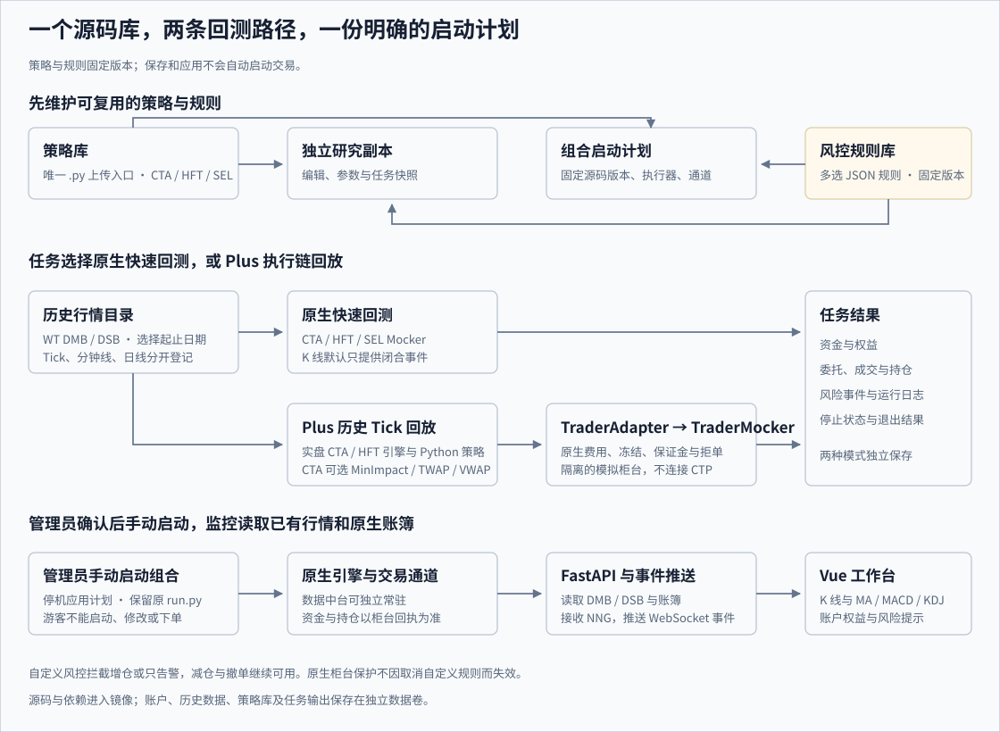
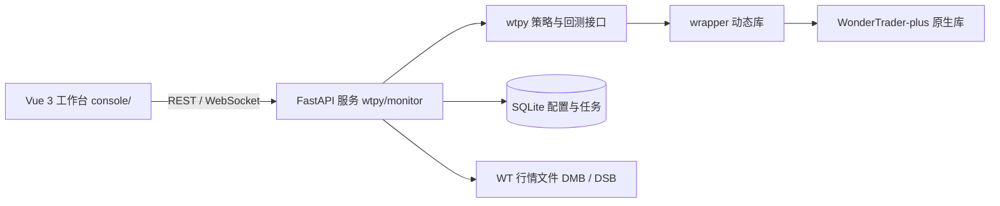

# wtpy-plus

基于 [wtpy](https://github.com/wondertrader/wtpy) 二次开发的 Python 接口与 Web 工作台，
保留上游来源与 MIT 许可，不是 wtpy 官方发行版。

原版 wtpy 是 WonderTrader 的 Python 子框架：封装 C++ 引擎、回测与数据接口，
提供 CTA/HFT/SEL 策略基类、回测引擎、数据工具和监控服务。
本仓库在 wtpy 之上扩展出完整网页工作台，并与 [WonderTrader-plus](https://github.com/newbigdeng/WonderTrader-plus) 配套：
C++ 负责引擎、执行器、模拟柜台与账户账簿；Python 负责策略接口、任务编排和网页服务。



## 架构介绍

工作台从上到下分为五层，回测、实盘与采集都由同一套服务编排：



| 层 | 目录 | 职责 |
| --- | --- | --- |
| 前端 | `console/` | Vue 3 单页应用，承载监控、回测、策略库、历史数据、研究、分析终端等页面 |
| 服务 | `wtpy/monitor/` | FastAPI 应用 `WtMonSvr.py`，注册业务路由，管理子进程、任务与推送 |
| 接口 | `wtpy/` | 策略基类与上下文、`WtEngine`/`WtBtEngine`/`WtDtEngine`、消息队列、数据伺服 |
| 桥接 | `wtpy/wrapper/` | 用 ctypes 加载 C++ 动态库；Windows 用 `x64/*.dll`，Linux 用 `linux/lib*.so` |
| 原生 | WonderTrader-plus | 引擎、执行器、模拟柜台、数据组件与账户账簿 |

**服务入口。** `wtpy/monitor/WtMonSvr.py` 创建 FastAPI 应用，挂载静态控制台、会话与 GZip 中间件，
并注册策略控制、托管策略、策略库、历史目录、风控库、风控中心、通道配置、行情订阅、
历史数据、Plus 回测、研究空间、交易风控等路由。`PushSvr.py` 负责 WebSocket 推送，
`WatchDog.py` 负责进程守护，`DataMgr.py` 用 SQLite 保存用户、组合、任务与配置。

**进程边界。** 工作台是常驻的 FastAPI 进程；行情采集、策略组合与回测任务由 `WatchDog`
按需启动为本机子进程，补数由补数接口或独立部署的 `BackfillServer.py` 处理。
回测与采集失败不会阻塞工作台；工作台关闭时会按其启动参数停止 WatchDog 托管的子进程，
独立部署的采集/交易进程不受影响。

**两套回测。**
- 快速回测：`WtBtMon.py` 生成配置并启动独立回测子进程（`backtest_runner.py.tpl`），
  走 wtpy 的 `WtBtEngine`，对应 C++ 的 `WtBtCore` 撮合链，可选 CTA 成交模型。
- Plus 回测：`PlusBacktest.py` 按任务隔离目录与环境，`PlusReplayRunner.py`
  沿「WT 数据写入 → 实盘引擎 → 原生交易路径」回放历史行情，交易侧接入隔离的
  `TraderMocker` 模拟柜台；支持 MinImpact、TWAP、VWAP 执行器，可配置资金、费用和滑点。
- 两种模式各有报告来源：快速回测由 `WtBtMon.py` 汇总资金、成交与信号，Plus 回测由
  `PlusReport.py` 生成原生回放的绩效、权益曲线与成交明细派生视图；监控页的策略绩效卡片
  由 `BacktestPerformance.py` 合并已完成任务的快照。

**权限模型。** `DataMgr` 保存用户与角色，`Roles.py` 定义只读、操作、研究与管理四类能力，
`GuestAccess.py` 提供游客只读白名单（默认关闭）。角色包括 guest、viewer、operator、admin、
superman、trader、researcher、risker；回测、研究与终端页面仅对 researcher、admin、superman 开放，游客为只读例外。

## 功能介绍

工作台按页面组织，覆盖行情、策略、回测、风控与研究全流程：

**监控中心（`/monitor`）**
- 组合、策略、账户与持仓总览，真实柜台权益曲线与资金重置分段。
- 行情看盘：K 线与 MA、成交量、MACD、KDJ 指标，悬浮提示与缩放联动。
- 委托、成交、持仓与快照时间；柜台断开或数据过期时明确标注未知。
- 风险告警与静默；策略暂停决策与原生过滤分别操作。

**调度中心（`/schedule`）**
- 进程启停、定时任务、进程守护与配置对比。
- 数据中台订阅切换：期货、商品期权、加密货币分别维护订阅清单与存储目录。
- 采集、补数与回测任务的状态和日志。

**在线回测（`/backtest`）**
- 快速回测与 Plus 回测切换，覆盖 CTA、HFT 策略；股票、期货、商品期权与加密货币共用入口（期货与商品期权链路最完整）。
- 自选数据集、起止日期、资金、费用、滑点与执行器参数。
- 报告页：统计摘要、权益与回撤、月度日收益、分页成交明细、K 线买卖点标记。
- 品种连续回测：按前一交易日持仓量切换主力合约，复权只用于信号衔接，成交按真实合约价格记账。

**策略管理（`/strategies`）**
- 策略库按 CTA、HFT、SEL 分类保存源码，每次保存生成新版本。
- 回测与研究从库复制代码，交易组合显式选择库版本后才生效。
- 托管启动计划：草稿、应用、手动启动三步分离；改动有持仓策略的代码或参数会被拒绝。
- 从库删除只归档，已有计划仍能读取原版本。

**历史数据（`/history`）**
- 按资产、合约和类型浏览 Tick、1 分钟、5 分钟与日线文件及其覆盖范围。
- 补数入口按资产提供：期货 AkShare / Tushare / CNEquity，股票 Tushare / 腾讯 / 东方财富，
  商品期权新浪 / 信易 EDB / Tushare / 东方财富，加密货币 Coinbase / Binance。
- `BackfillServer.py` 可独立部署为补数服务，只向各资产历史目录写入。

**风控库（`/risk-library`）**
- 规则类型包括单次增仓、目标仓位、可用资金、当日亏损和权益回撤。
- 规则版本独立保存，回测与组合按固定版本执行；预交易规则拦截增仓，告警规则只记录。
- 保留减仓与撤单，资金不足仍由原生柜台拒单。

**研究（`/research`）**
- 研报、论文、博客资料入库、摘要与 Skill 生成，可人工增删。
- 书籍与 Skills：上传书籍可生成阅读卡与 Skill，按类型分类查看和删除。
- 方法模板、因子项目与独立实验；实验冻结项目、参数和历史数据范围。
- 因子图表：IC 时序、IC 分布与综合统计、信号净值曲线。
- 因子自动化：由研报、论文与博客驱动候选因子，经筛选、原生回放与验证后进入因子库。
- 自动化研究记录每个步骤、工具调用、读取的 Skill 与产出。
- 因子版本与组合研究分别保存，进入交易前仍走原生回测与人工确认。

**分析终端（`/terminal`）**
- 分析工具：DCF、现金流、组合优化、收益与风险指标。
- 定价工具：期权、债券、远期、互换与日期计算，输出权利金与 Delta、Vega 等敏感度。
- 数据中心：固定公开来源、按需请求与时间戳缓存；AI 研究调用受每日共享额度限制，MCP 工具为本机只读计算，不占用模型额度。
- 流程画布：把公开数据、收益与风险分析步骤串成可复用工作流。
- 前端通过 `TerminalRoutes.py` 认证转发到独立回环服务，后端位于 `scripts/research-terminal/`。

**多资产与期权**
- 股票、期货、商品期权和加密货币各有独立的工作目录、采集进程与历史数据入口。
- 商品期权：合约链浏览、波动率曲面、五项敏感度、跨品种价差；日 K 与分钟看盘、历史估值库。
- 期权回测（历史回放口径）：多腿、跨到期移仓、行权与指派清算、行权后期货持仓盯市。
- 期权模拟可对接 CTP 仿真柜台，以独立进程完成买方开平与逐笔对账，不影响期货采集与交易进程。
- 游客可只读访问监控与公开页面，不能启停进程、运行回测或修改配置。

**接口手册（`/api-manual`）**：策略回调与上下文接口说明，含 CTA 下单、数据查询与回测设置。

## 技术介绍

**后端**
- Python 3（包元数据要求 ≥3.11；官方镜像基于 Ubuntu 26.04 的 Python 3.14 环境）、FastAPI、Uvicorn、Starlette，SQLite 保存配置、任务与用户。
- 依赖由 `requirements-plus.lock` 固定：FastAPI 0.143.2、Uvicorn 0.54.0、Starlette 1.8.0、
  pandas 2.3.3、numpy 2.5.4、psutil 7.2.2、pytest 9.1.1 等；约束见 `requirements-plus.in`。
- 数值与数据处理：numpy、pandas、XlsxWriter；网络与解析：httpx、websockets、pyquery、chardet。
- 包名仍为 `wtpy`，版本 0.9.9.3，导入路径 `import wtpy` 不变。

**前端**
- Vue 3.5、Pinia 4、Vue Router 5、Element Plus 2、ECharts 6、CodeMirror 6。
- Node.js 22、Vite 8 构建；Playwright 做页面端到端测试，`console/tests/` 含 27 个文件（其中 1 个 fixture）。
- 页面与组件按功能拆分在 `console/src/components/`，接口封装在 `console/src/js/`，黑主题样式在 `console/src/themes/`。

**构建与部署**
- 两阶段 Docker 构建：`node:22-slim` 镜像编译前端，再基于 `wondertrader-plus:native` 镜像
  安装 Python 依赖、复制前端产物与原生动态库。
- 工作台容器入口固定监听 `8100`（服务代码默认 8080，由 `docker/run_workbench.py` 指定），
  数据目录 `/data`；入口负责初始化会话密钥、管理员账号与数据库。数据卷保存账户、任务与运行结果。
- 构建参数：`WITH_MARKET_DATA=1`（默认安装 AkShare 等外部行情依赖，设为 0 可跳过）、
  `WITH_CTP_QUOTES=1`（安装 openctp-ctp 6.7.11.0 与 QuantLib 1.39，并补齐 `zh_CN.GB18030` locale）。
- 提供 `compose.yaml`，`docker compose up -d --build` 即可启动。

```bash
git clone -b wt-plus https://github.com/newbigdeng/WonderTrader-plus.git
git clone -b py-plus https://github.com/newbigdeng/wtpy-plus.git
docker build -t wondertrader-plus:native ./WonderTrader-plus
docker build -t wtpy-plus:latest ./wtpy-plus
docker run -d --name wt-plus-workbench --init \
  -p 127.0.0.1:8100:8100 -v wt-plus-data:/data \
  --stop-timeout 30 wtpy-plus:latest
```

首次启动会创建管理员并生成初始密码，数据保存在 `/data` 数据卷中。示例卷名可自行修改，`compose.yaml` 使用 `workbench-data`。

**测试**
- `tests/` 下 48 个 unittest，覆盖账户与权益、资产隔离、回测与 Plus 回放时钟、
  策略库与托管策略、历史目录与补数、风控库、研究空间与研究版本、期权分析与到期清算、
  权限与游客访问、策略重置与对账等模块。
- `console/` 使用 Playwright 验证页面流程；`scripts/research-terminal/` 另有独立测试。
- `demos/` 提供 CTA、HFT、SEL 等示例策略与各引擎演示。

**配套**
- C++ 仓库：[WonderTrader-plus](https://github.com/newbigdeng/WonderTrader-plus)（`wt-plus` 分支），
  提供引擎、执行器、模拟柜台和数据组件。
- 运行 Plus 功能必须使用配套构建的原生库，`wtpy/wrapper/linux/` 由镜像负责放入。

## 相关仓库与许可

- 上游项目：[wtpy](https://github.com/wondertrader/wtpy)、[WonderTrader](https://github.com/wondertrader/wondertrader)
- 配套 C++ 仓库：[WonderTrader-plus](https://github.com/newbigdeng/WonderTrader-plus)
- 许可：[MIT](LICENSE)。
